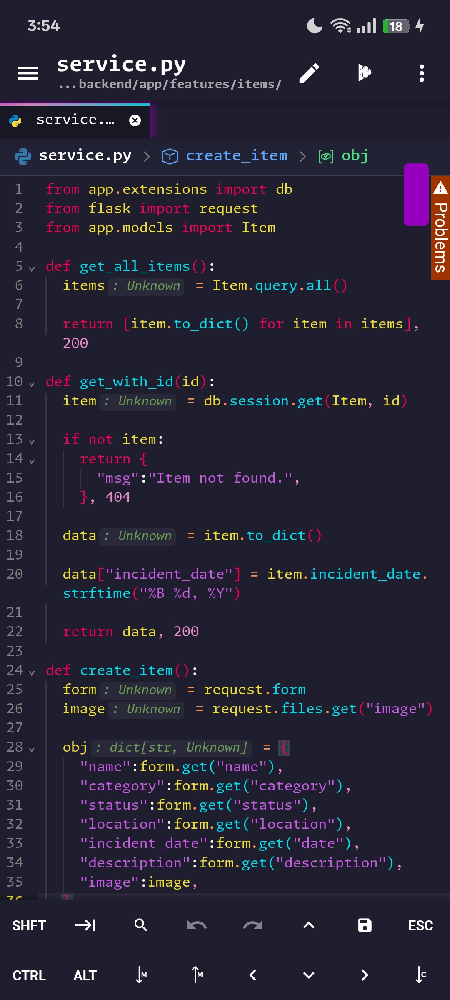
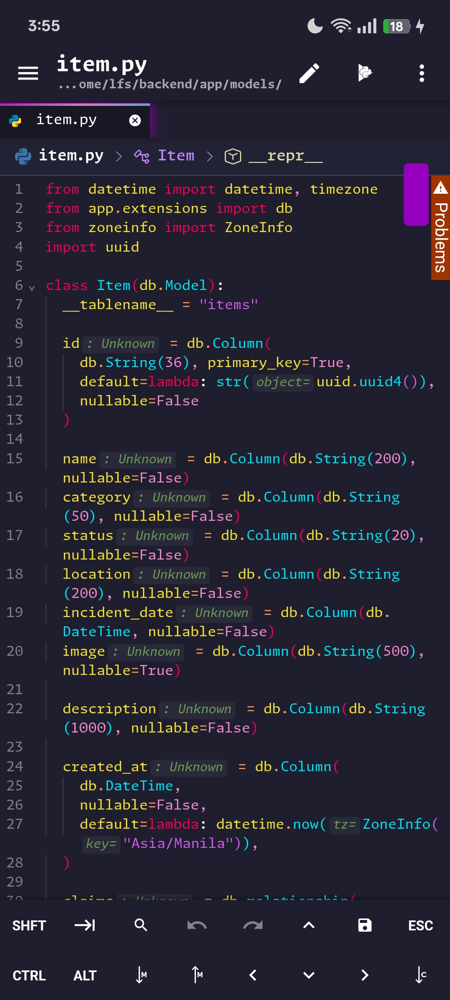
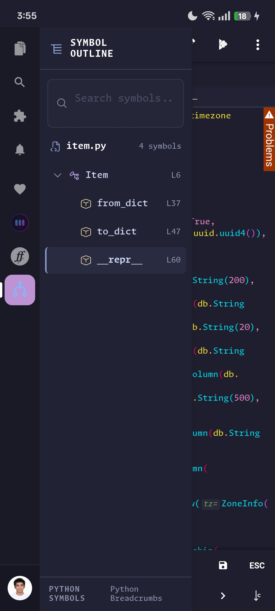

# Python Breadcrumbs

A Python-focused navigation extension for Acode, powered by Tree-sitter. Navigate your Python code with intelligent breadcrumbs and a dedicated Symbol Outline sidebar.

## Features

- **Tree-sitter-powered parsing** for accurate Python syntax analysis.
- **Breadcrumb navigation** for easier navigation through Python code.
- **Symbol Outline sidebar** for viewing your code structure.
- **Hierarchical symbol navigation** for classes, functions, and methods.
- **Symbol search** to quickly find declarations in your file.
- **Expand and collapse controls** to manage the symbol hierarchy.
- **Active symbol highlighting** to identify your current location in the code.
- **Automatic updates** when switching between editor tabs.
- **Lightweight integration** designed specifically for Acode.

## Screenshots

### Function Preview

### Classes Preview

### Hierarchy Preview

## Requirements

- Acode editor.
- Android device running a compatible version of Acode.

## Version

**Current version:** 2.0.0

**Price:** ₹30 INR

## Developer

Created and maintained by **Zylle Mojica**.

## Contact

Have a suggestion, found a bug, or want to discuss the project?

- GitHub: [Ryze282747](https://github.com/Ryze282747)
- Instagram: [@ryzexlsv](https://www.instagram.com/ryzexlsv/)

## License

Python Breadcrumbs is proprietary software.

Copyright (c) 2026 Ryze. All Rights Reserved.

Unauthorized copying, modification, distribution, or redistribution is prohibited without prior written permission from the copyright owner.

See the [LICENSE](LICENSE) file for the complete license terms.
